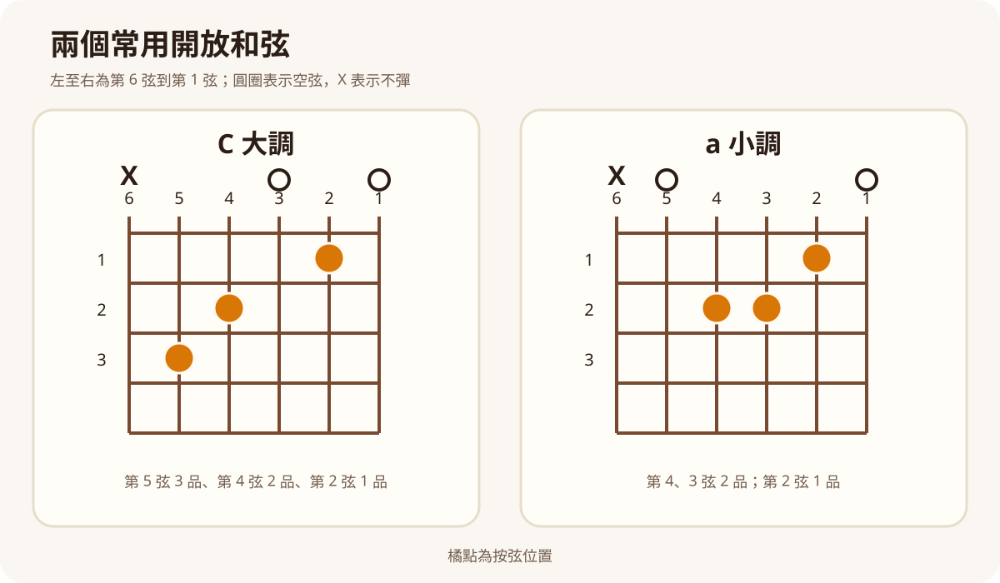

# C大調與a小調基礎開放和弦

## 核心定義
開放和弦是指一些弦保持空弦狀態，使和弦更容易按出，特別適合新手。C 大調與 a 小調是最常見的入門組合。

## C 大調
C大調常見按法：
- 第 1 弦：空弦
- 第 2 弦：1 品
- 第 3 弦：0
- 第 4 弦：2 品
- 第 5 弦：3 品
- 第 6 弦：X

這個和弦給人明亮、穩定、適合歌唱的感覺，常出現在流行與民歌中。

## a 小調
a 小調常見按法：
- 第 1 弦：0
- 第 2 弦：1 品
- 第 3 弦：2 品
- 第 4 弦：2 品
- 第 5 弦：0
- 第 6 弦：X

這個和弦常見於情緒柔和的歌謠與流行曲中，與 C 大調相互搭配非常自然。

## 轉換要點
- 先穩定每個弦的聲音
- 以最小移動縮短指頭移動距離
- 每次轉換時清楚檢查鬆弦與壓弦感

## 常見誤區
- 只看和弦圖不實際按出聲音
- 把所有指頭都壓得太重
- 用力太大造成雜音與壓力不均

## 相關條目
- [[初學者高效和弦轉換兩大心法]]
- [[六線譜TAB與和弦圖識讀]]
- [[自然大調音階與三和弦構成]]
- [[src-音伴吉他入門零基礎自學教程]]
