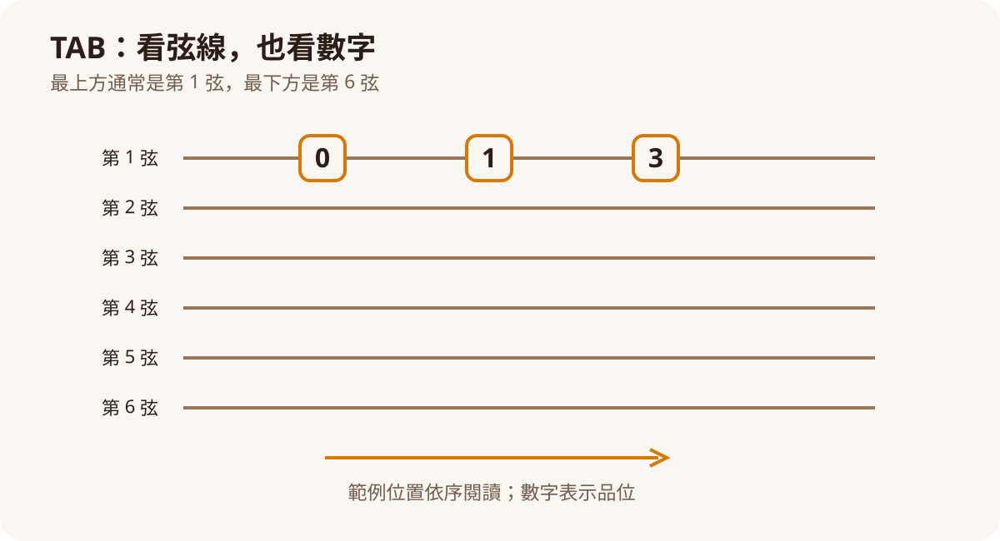

# 六線譜TAB與和弦圖識讀

## 核心定義
六線譜（TAB）是用 6 條線來表示吉他弦位的位置，方便演奏者快速知道要按哪一格哪一根弦。和弦圖則是直接表示按哪裡形成哪個和弦。

## TAB 的基本理解
- 最上方一線通常是第 1 弦（高音弦）
- 最下方一線通常是第 6 弦（低音弦）
- 數字代表品位位置
- 連續數字常表示連續音，通常是順序演奏

## 和弦圖的閱讀
- 圓圈或 X 表示弦是否開放或不撥
- 數字表示品位位置
- 左側通常標示第 6 弦到第 1 弦

## 讀譜方法
1. 先看和弦圖，確認哪根弦要按住
2. 以音準為主，別急著追求速度
3. 先分解成單弦，再整體掃弦

## 常見誤區
- 把 TAB 當成正確的音高樂譜
- 忽略每一行的弦序與方向
- 只看和弦圖不實際按聲音確認

## 相關條目
- [[簡譜音名唱名與音符時值]]
- [[自然大調音階與三和弦構成]]
- [[C大調與a小調基礎開放和弦]]
- [[src-音伴吉他入門零基礎自學教程]]
