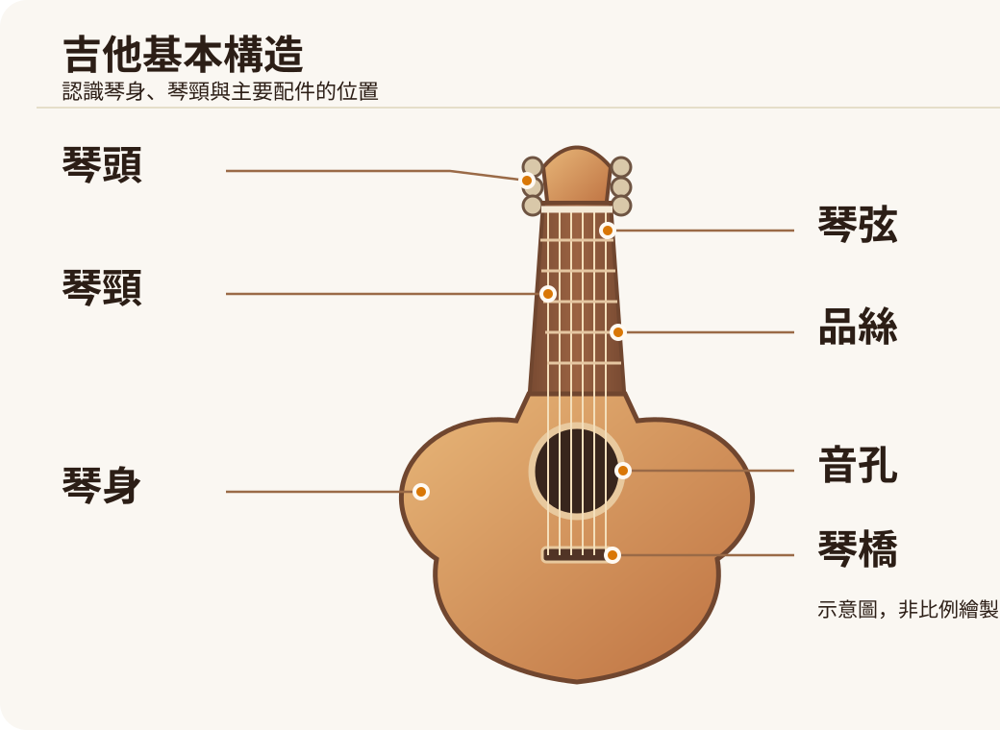

# 吉他構造與三大琴種比較

## 核心定義
吉他由琴身、琴頸、弦、品絲、音孔與橋座等基本部件構成。不同琴種適合不同音色、演奏風格與學習需求。

## 主要構造
- **琴身（Body）**：產生共鳴與音色。
- **琴頸（Neck）**：容納品格與弦列，影響手感。
- **品位（Frets）**：標示音高位置。
- **弦（Strings）**：通常 6 根，依序為 E-A-D-G-B-E。
- **音孔（Sound Hole）**：木吉他常見共鳴孔。

## 三大琴種比較
### 1. 民謠吉他（Acoustic Guitar）
- 特色：適合自彈自唱、流行與民歌。
- 優點：便攜、簡單、適合入門。
- 適合：初學者尋找穩定且容易上手的樂器。

### 2. 電吉他（Electric Guitar）
- 特色：需搭配擴音器，音色較明亮、可塑性高。
- 優點：適合流行、搖滾與節奏彈奏。
- 適合：偏好強烈節奏感、電聲音色者。

### 3. 古典吉他（Classical Guitar）
- 特色：尼龍弦、柔和音色，適合指彈。
- 優點：手感柔和、對指力較友善。
- 適合：想從指彈與古典流派開始者。

## 實用判斷
如果目標是「快速進入吉他自學與休閒演奏」，民謠吉他通常是最適合的起點；若重視指彈細膩與柔和音色，古典吉他也具優勢。

## 常見誤區
- 以為琴種越貴就越適合初學。
- 忽略樂器的手感、音色與演奏習慣差異。
- 只看外觀不看琴頸與弦距的舒適程度。

## 相關條目
- [[吉他選購與日常保養]]
- [[標準定弦與五品調音法]]
- [[三點持琴法與左右手基本手型]]
- [[src-音伴吉他入門零基礎自學教程]]
