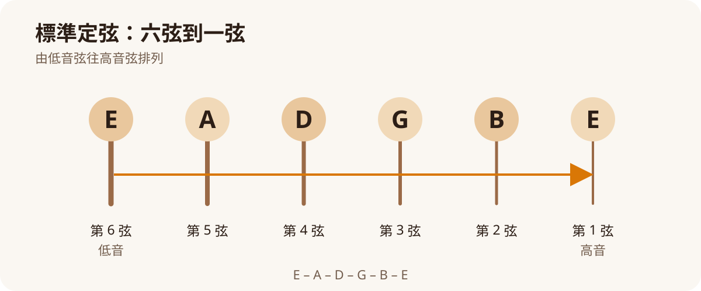

# 標準定弦與五品調音法

## 核心定義
吉他標準定弦為從低到高：E-A-D-G-B-E。調音是保證樂器與歌曲節奏、音高一致的關鍵步驟。

## 標準定弦
- 第 6 弦：E
- 第 5 弦：A
- 第 4 弦：D
- 第 3 弦：G
- 第 2 弦：B
- 第 1 弦：E

## 五品調音法
五品調音法是利用「第 5 品音高等於下一根空弦」的關係來快速校準。

例如：
- 第 5 品的 A 弦音 = 第 4 品的 D 弦音，依此類推
- 透過交叉比較，可達成相對校準

## 實作順序
1. 先校準 6 弦 E
2. 以 5 品法調 5 弦 A
3. 依序調 4、3、2、1 弦
4. 再用整體聽感檢查音準與共鳴

## 常見誤區
- 只用耳朵而不做相對校準
- 亂扭琴弦，導致琴頸受力不均
- 忽略空弦與 5 品之間的彼此關係

## 相關條目
- [[三點持琴法與左右手基本手型]]
- [[六線譜TAB與和弦圖識讀]]
- [[吉他選購與日常保養]]
- [[src-音伴吉他入門零基礎自學教程]]
