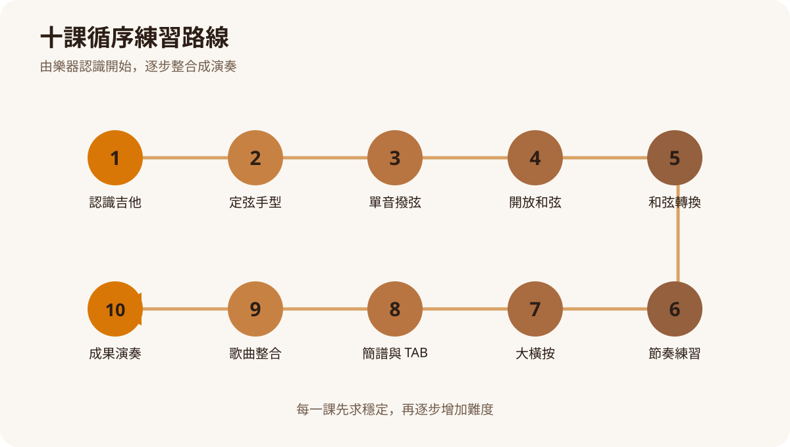

# 音伴十課初學循序練習課表

## 核心定義
由簡單到穩定的循序練習，是吉他初學者維持長期成長的關鍵。此課表以低壓力、規律性與穩定音準為第一原則。

## 逐課建議
### 第 1 課：認識吉他與工具
- 熟悉弦、品位、琴身與琴頸
- 檢查是否能正確持琴

### 第 2 課：定弦與基本手型
- 進行標準定弦
- 練習基本手指分工與手腕鬆弛

### 第 3 課：單音與撥弦
- 數字音與節奏感
- 讓每個音都能清晰發聲

### 第 4 課：開放和弦入門
- C 大調與 a 小調
- 先慢速，後穩定

### 第 5 課：和弦轉換
- 以小範圍轉換為核心
- 不要用力過猛

### 第 6 課：簡單節奏練習
- 先以四拍節奏穩定為主
- 可結合簡單一個和弦循環

### 第 7 課：大橫按與延伸和弦
- 初步感受食指壓弦的強度
- 計劃視能力增加更多和弦型

### 第 8 課：簡譜與 TAB 讀法
- 將音名與按法連結
- 關鍵是理解「音高」與「位置」

### 第 9 課：節奏與和弦配合
- 將節奏與進行順序結合
- 從一首短歌開始練習

### 第 10 課：整體復盤與小成果演奏
- 回顧所有重點
- 以簡短歌曲作為統整檢驗

## 常見誤區
- 一次練習太長，導致姿勢變差
- 只練和弦不練節奏
- 太快開始高難度和弦或大橫按

## 相關條目
- [[C大調與a小調基礎開放和弦]]
- [[標準定弦與五品調音法]]
- [[右手撥弦與手指掃弦技巧]]
- [[src-音伴吉他入門零基礎自學教程]]
