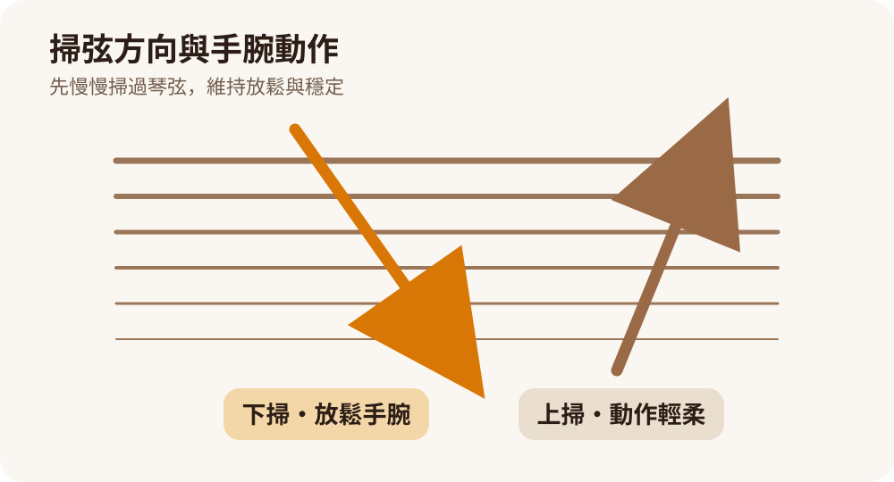

# 右手撥弦與手指掃弦技巧

## 核心定義
右手的撥弦與掃弦，是形成節奏和音色的關鍵。正確的手動作不僅讓和弦更清楚，也避免雜音與力量過大。

## 撥弦法
- 以指尖輕觸弦，讓弦能自由振動
- 初學者可從單音練習開始，再過渡到和弦
- 重要的是節奏穩定，而不是音量過大

## 掃弦法
- 從低音到高音，順序經過每一根弦
- 勞動節奏可先用簡單下掃或上下掃練習
- 手腕應維持自然彈性，避免僵硬

## 先練習什麼
1. 單弦輕撥
2. 兩弦交替練習
3. 低音和弦簡易下掃
4. 兩拍/四拍節奏穩定化

## 常見誤區
- 撥弦過重導致音量混亂
- 掃弦太快但節奏不穩
- 右手只用肘部，不使用手腕與指尖協調

## 相關條目
- [[三點持琴法與左右手基本手型]]
- [[大橫按封閉和弦技巧]]
- [[音伴十課初學循序練習課表]]
- [[src-音伴吉他入門零基礎自學教程]]
